


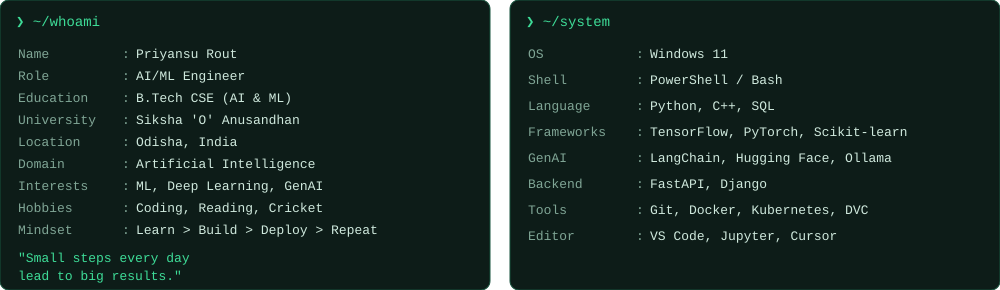

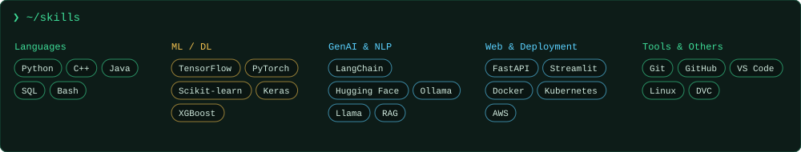

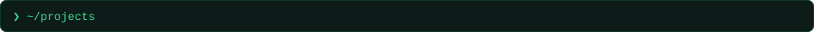

<a href="https://github.com/Priyansu-Rout/breast-cancer-prognosis">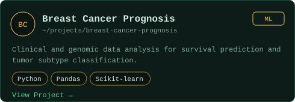</a>
<a href="https://github.com/Priyansu-Rout/resume-analyzer-pro">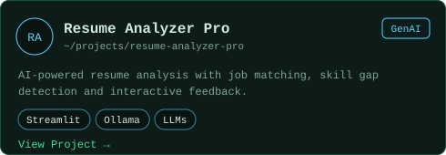</a>
<a href="https://github.com/Priyansu-Rout/diabetes-prediction">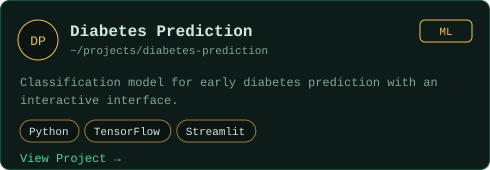</a>
<a href="https://github.com/Priyansu-Rout/rag-study-assistant">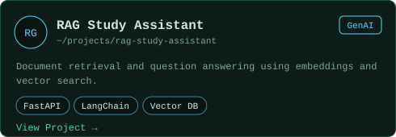</a>

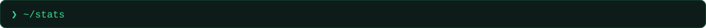

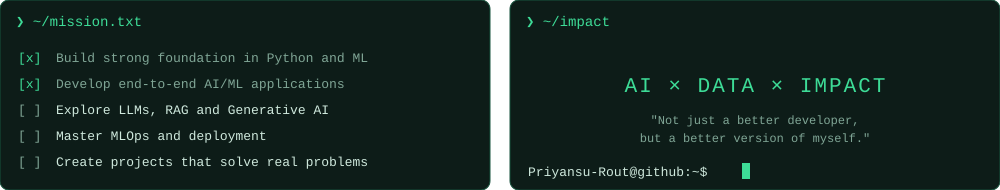

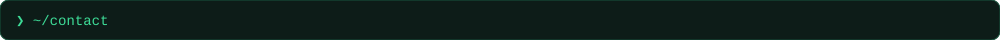

